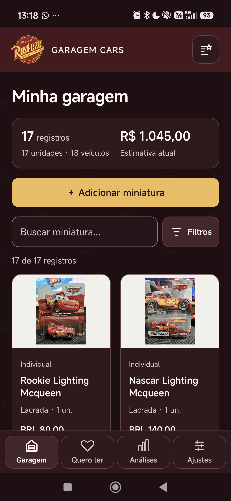
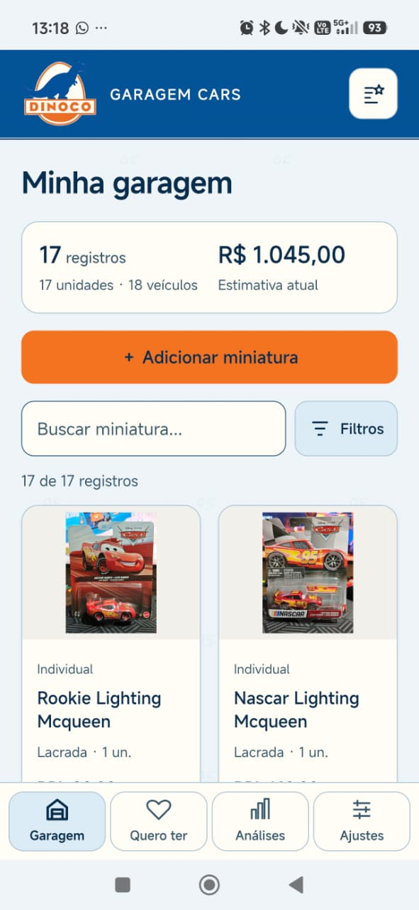
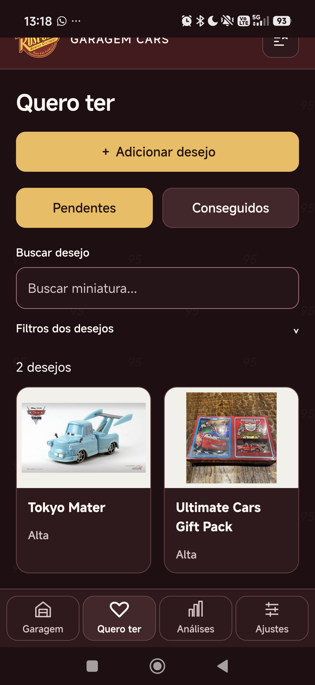
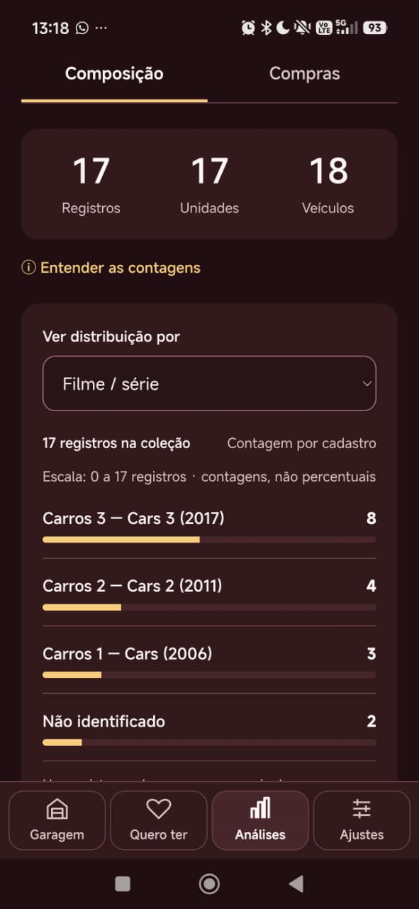
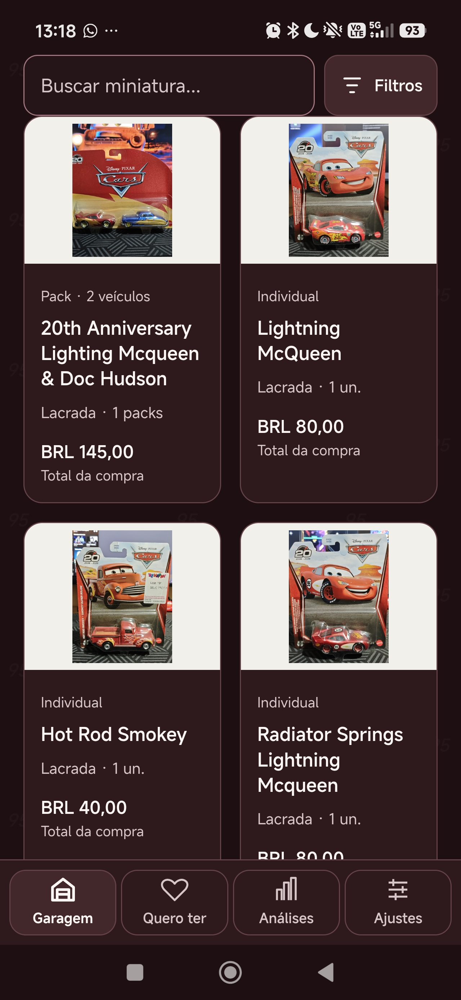

  

<h1 align="center">Garagem Cars</h1>

<strong>Sua coleção, cada detalhe.</strong>

  Um lugar para organizar suas miniaturas Disney Pixar Cars da Mattel, 
  acompanhar suas compras e planejar as próximas aquisições.

  <strong>Android 8.0+</strong> · Coleção local e offline · Em português

  <a href="https://github.com/JotaaVe/Garagem-Cars/releases/latest"><strong>Baixar o APK</strong></a>
  &nbsp;·&nbsp;
  <a href="https://github.com/JotaaVe/Garagem-Cars/releases">Novidades das versões</a>
  &nbsp;·&nbsp;
  <a href="https://github.com/JotaaVe/Garagem-Cars/issues">Sugestões e problemas</a>

---

## Uma garagem para a sua coleção

O **Garagem Cars** nasceu de uma coleção pessoal. A proposta é reunir fotos, personagens, variantes, embalagens e informações de compra em um catálogo fácil de consultar — tanto para lembrar o que você já tem quanto para decidir o que ainda quer encontrar.

O cadastro manual e a consulta da coleção funcionam **sem internet e sem criar uma conta**. Os dados ficam no aparelho; os recursos online são complementares.

## Conheça o aplicativo

### Dois temas, a mesma garagem

<table>
  <tr>
    <th align="center">Rust-eze</th>
    <th align="center">Dinoco</th>
  </tr>
  <tr>
    <td align="center"></td>
    <td align="center"></td>
  </tr>
</table>

### Do próximo desejo aos detalhes do acervo

<table>
  <tr>
    <th align="center">Quero ter</th>
    <th align="center">Análises</th>
  </tr>
  <tr>
    <td align="center"></td>
    <td align="center"></td>
  </tr>
</table>

  
<strong>Ver mais: miniaturas individuais e packs na coleção</strong>

  

As capturas mostram o aplicativo Android com uma coleção cadastrada. Fotos, nomes e valores são exemplos dessa coleção, não um catálogo incluído no app.

## O que você pode fazer

| Área | Recursos |
| --- | --- |
| **Minha garagem** | Cadastre miniaturas com várias fotos, condição, personagem, variante, códigos, ano, produções, classificações e série da embalagem. Encontre os itens com busca, filtros e ordenação. |
| **Quantidades e packs** | Diferencie registros, unidades de compra e veículos. Informe os personagens e suas quantidades dentro de cada pack, mantendo a variante separada do personagem. |
| **Quero ter** | Organize os próximos desejos por prioridade e acompanhe Pendentes e Conseguidos, sem misturá-los aos gastos da garagem. |
| **Análises** | Consulte a composição da coleção, distribuições por categoria e compras por período, com distinção entre custo histórico e estimativa pelo câmbio atual. |
| **Compartilhamento** | Escolha fotos, revise a mensagem e compartilhe pelo Android. Prepare também textos de venda com preço e condições, sem alterar os dados de compra do cadastro. |
| **Aparência** | Escolha entre seis temas, incluindo Rust-eze e Dinoco. Ajuste animações e redução de movimento conforme sua preferência. |
| **Backup** | Exporte coleção, desejos e fotos. Configure lembretes e confira o resumo do arquivo antes de restaurar. |

### Detalhes que fazem diferença

- **Fotos para consultar de perto:** galeria com ampliação e escolha da imagem principal.
- **Nomes organizados:** reutilize personagens e variantes já cadastrados, com sugestões de grafia para revisar.
- **Filtros relevantes:** as opções acompanham os registros existentes em cada área; os formulários continuam oferecendo todas as opções de cadastro.
- **Histórico de aquisição:** registre opcionalmente data, pessoa ou loja, moeda e preço pago.
- **Novidades no próprio app:** leia as notas da versão instalada offline e verifique novas atualizações quando estiver conectado.

## Baixar e começar

**Requisito: Android 8.0 ou posterior.**

1. Acesse a [última versão publicada](https://github.com/JotaaVe/Garagem-Cars/releases/latest).
2. Em **Assets**, baixe o arquivo `Garagem-Cars-<versão>.apk`.
3. Abra o arquivo no celular e siga as instruções do Android. Se solicitado, permita a instalação pela origem usada para abrir o APK.
4. No aplicativo, toque em **Adicionar miniatura** para começar sua garagem.

**Já usa o Garagem Cars?** Instale o novo APK sobre a instalação atual, **sem desinstalar o aplicativo nem limpar seus dados**. Mantenha também um backup com fotos em um local seguro fora do app.

O aplicativo pode avisar quando há uma nova versão e baixar o APK. A instalação sempre depende da sua confirmação no Android.

## Seus dados ficam com você

A coleção, as fotos, os desejos e as configurações ficam armazenados no aparelho. O backup permite levar esses dados para outro dispositivo ou recuperá-los depois; ele precisa ser exportado e guardado por você. Não há sincronização automática da coleção com uma conta online.

Ao compartilhar uma miniatura, você escolhe as fotos e revisa o texto antes de abrir o compartilhamento do Android. Dados de aquisição não são incluídos automaticamente na mensagem.

  
<strong>Recursos online: IA, wiki, câmbio e atualizações</strong>

### Identificação com IA — opcional

A integração utiliza o **Google Gemini** e exige uma chave de API configurada pelo usuário. Quando uma análise é solicitada, as fotos selecionadas são enviadas ao serviço. A disponibilidade depende da chave, do modelo e dos limites do provedor.

As sugestões devem ser revisadas: a IA não comprova autenticidade, raridade ou valor de mercado. Com a IA desativada, câmera, galeria e cadastro manual continuam disponíveis.

### Referências da wiki

A consulta integrada auxilia o preenchimento com revisão antes de aplicar os dados e tem um controle independente da IA. **Atualmente, a proteção da wiki pode bloquear as consultas.** O app informa essa falha; ela não significa que a miniatura não existe na fonte. O cadastro manual continua disponível.

A busca é geral: ainda não há um recorte exclusivo para a linha Basic (1:55).

### Câmbio e novas versões

As cotações ajudam a estimar valores em reais sem substituir o custo histórico informado. A consulta de câmbio e a verificação de versões no GitHub dependem de conexão.

Pessoa ou loja de aquisição, data, preços e notas pessoais não são enviados à IA nem à wiki.

## Sobre o projeto

Este repositório apresenta e distribui o **APK Android do Garagem Cars**, um aplicativo de coleção local em desenvolvimento. A ideia de uma comunidade de compra e venda está em uma **demonstração separada** e não faz parte dos recursos disponíveis neste APK.

Quer acompanhar a evolução? Consulte as [notas de lançamento](https://github.com/JotaaVe/Garagem-Cars/releases). Para sugerir melhorias ou relatar um problema, abra uma [Issue](https://github.com/JotaaVe/Garagem-Cars/issues), informando a versão do app, o aparelho e os passos para reproduzir a situação. Não publique chaves de API ou informações pessoais.

---

<strong>Garagem Cars · Sua coleção, cada detalhe.</strong>

Projeto independente, sem vínculo com Mattel, Disney ou Pixar. Marcas, personagens e logos pertencem aos seus respectivos titulares.

